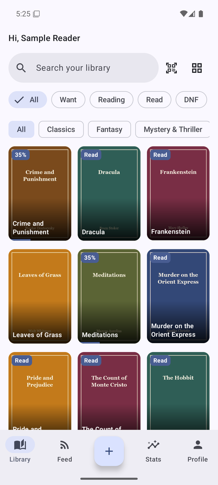
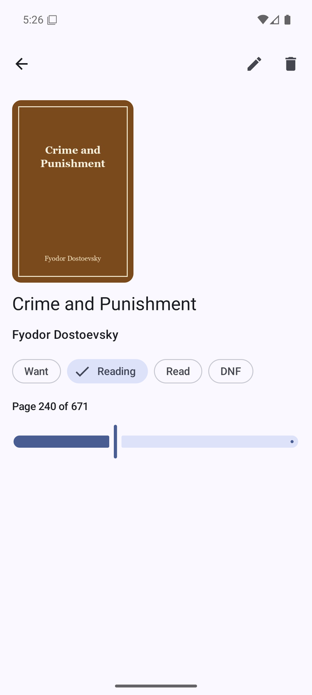
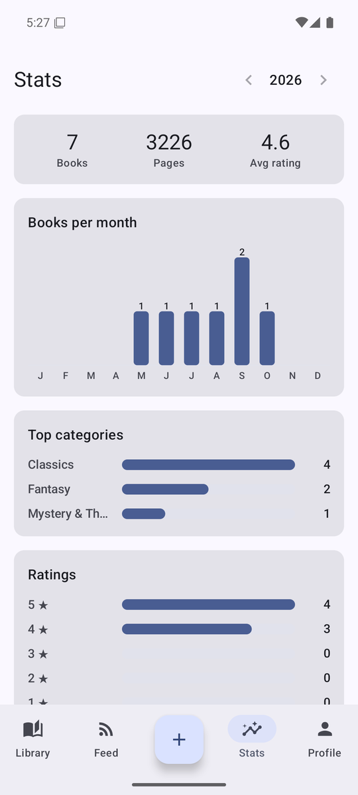
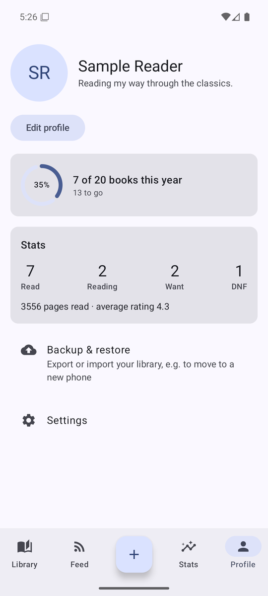

# Words and Wounds

A personal, offline book library for Android, like a private Goodreads that lives on your phone.
Add your books, track what you are reading, and see your reading year at a glance.
Built with Kotlin and Jetpack Compose (Material 3 Expressive). No account and no cloud: your data stays on the phone.

<p>
  
  
  
  
</p>

*The screenshots use made-up sample books.*

## What it does

- **Library:** covers, a list, or captions; search by title, author or notes; filter by status (Want, Reading, Read, DNF) and by category.
- **Add books** by scanning an ISBN, photographing a cover, searching by title, or typing them in. The app warns you if the book is already in your library.
- **Track progress** with a page slider. Reaching the last page marks the book as read.
- **Stats and profile:** books per month, top categories, ratings, and a yearly reading goal.
- **Feed:** news from book-related RSS feeds.
- **Backup and restore:** export everything to a `.zip` and import it on another phone. Importing the same file twice is safe.

## How to run

You need these first:

- [JDK 21](https://adoptium.net/) (the default `java` on your PATH may be older, so point `JAVA_HOME` at JDK 21)
- The [Android SDK](https://developer.android.com/studio) with the `platforms;android-37.2` package
- An Android phone with USB debugging on, or an emulator

### Build and install (Windows, PowerShell)

1. Tell the shell where Java and the Android SDK are (change the paths to yours):

   ```powershell
   $env:JAVA_HOME="C:\path\to\jdk-21"
   $env:ANDROID_HOME="C:\path\to\android-sdk"
   $env:Path="$env:JAVA_HOME\bin;$env:ANDROID_HOME\platform-tools;$env:Path"
   ```

2. Build and install on the connected phone or emulator:

   ```powershell
   .\gradlew.bat installDebug
   ```

   For a smaller, faster build, use `.\gradlew.bat assembleRelease` instead. The APK is written to `app/build/outputs/apk/release/app-release.apk`. It is signed with the debug key, so it installs over a debug install and keeps your data.

3. To check it worked, open **Words and Wounds** on the device. The library screen appears.

To only get the APK file (to copy to a phone), run `.\gradlew.bat assembleDebug`. It is written to `app/build/outputs/apk/debug/app-debug.apk`.

### Run the tests

```powershell
.\gradlew.bat testDebugUnitTest
```

## Moving your library

In the app, open **Profile → Backup & restore** to export or import a `.zip` backup.

## More

Design, plans and handoff notes are in [`docs/`](docs/): the spec is in [`docs/superpowers/specs/`](docs/superpowers/specs/), the plans in [`docs/superpowers/plans/`](docs/superpowers/plans/), and current status in [`docs/HANDOFF.md`](docs/HANDOFF.md).
