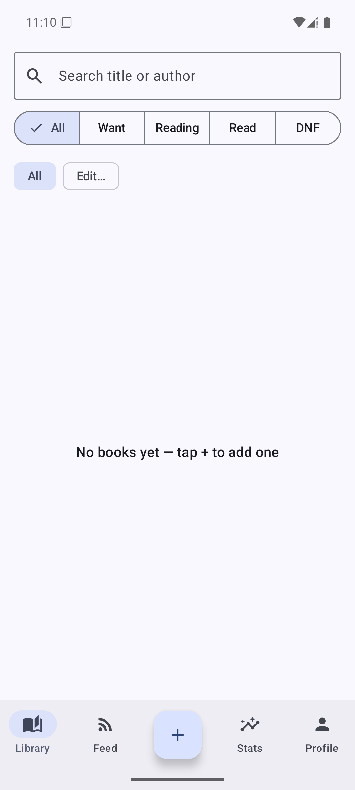

# Library App

A personal, offline-first book library for Android (Kotlin + Jetpack Compose, Material 3 Expressive).
Add books manually (camera scan, cover photos and on-device AI arrive in later phases), track
Want / Reading / Read / DNF with page progress, and organise them into categories.



## Status

Phase 1 of 7 (library core) is done. Design: [`docs/superpowers/specs/`](docs/superpowers/specs/) ·
plans: [`docs/superpowers/plans/`](docs/superpowers/plans/).

## How to run

Requirements: JDK 21, Android SDK with `platforms;android-37.2`, a phone (USB debugging on) or emulator.

```powershell
.\gradlew.bat installDebug        # build and install on the connected device
.\gradlew.bat testDebugUnitTest   # unit tests
```

The APK is written to `app/build/outputs/apk/debug/app-debug.apk` if you prefer to sideload it.
